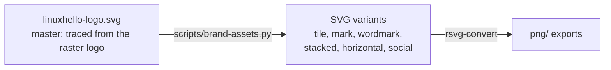

# Linux Hello brand

<p align="center">
  
</p>

The brand guide and logo files for [Linux Hello](https://github.com/LinuxHello/linux-hello), a session credential broker for the Linux desktop. Everything needed to make a Linux Hello visual: logo files, colours, type, illustration style and where each is used. Tokens for code are in [tokens/](tokens/).

| Topic | Note |
| :-- | :-- |
| Logo variants, clear space, minimum sizes, misuse | [logo.md](logo.md) |
| Palette, contrast, light and dark surfaces | [colour.md](colour.md) |
| Typefaces, weights, type scale | [typography.md](typography.md) |
| Drawing new artwork in the house style | [illustration.md](illustration.md) |
| GitHub, README, social cards, favicons, Plasma UI, diagrams, slides | [applications.md](applications.md) |
| Design tokens (JSON and CSS) | [tokens/tokens.json](tokens/tokens.json), [tokens/tokens.css](tokens/tokens.css) |

## Quick reference

| Element | Value |
| :-- | :-- |
| Name in prose | **Linux Hello** (two words) |
| Name in the wordmark and identifiers | **LinuxHello** (one word: "Linux" regular, "Hello" bold), e.g. `io.github.LinuxHello.*` |
| Primary colour | Hello Blue `#248DE0` |
| Ink | Navy `#263A53`, Shadow `#1F2E45` |
| Accent | Beak Orange `#F8982A` |
| Display typeface | Quicksand (SIL OFL 1.1) |
| Text typeface | Noto Sans (SIL OFL 1.1) |
| Code typeface | Noto Sans Mono (SIL OFL 1.1) |
| Default logo | [linuxhello-logo.svg](logo/linuxhello-logo.svg) on blue; [linuxhello-tile.svg](logo/linuxhello-tile.svg) for avatars and icons |

## Which logo file

| You need | Use |
| :-- | :-- |
| GitHub organisation avatar, app icon, favicon | `linuxhello-tile` ([SVG](logo/linuxhello-tile.svg), [PNG 1024](logo/png/linuxhello-tile-1024.png)) |
| README header, title slide on brand blue | [linuxhello-logo.svg](logo/linuxhello-logo.svg) |
| Header or footer on a white or light page | [linuxhello-horizontal-navy.svg](logo/linuxhello-horizontal-navy.svg) |
| Header on a brand-blue band | [linuxhello-horizontal-white.svg](logo/linuxhello-horizontal-white.svg) |
| Repository social preview | [PNG 1280×640](logo/png/linuxhello-social-preview-1280x640.png) |
| Penguin alone on a light background | [linuxhello-mark.svg](logo/linuxhello-mark.svg) |
| Anywhere on a dark background | the tile; never the transparent mark (see [logo.md](logo.md#backgrounds)) |

## Where the files come from



- The master is the only hand-supplied file. It is a colour-layer trace of the original raster logo (seven flat colours, text as outlines). It is the trace in linux-hello's `docs/assets/linuxhello-logo.svg`, with the layers restacked so the orange layers sit on top, which removes an orange fringe around the belly at small sizes.
- Every other logo file is generated: same paths, cropped, clipped or recoloured. Do not edit generated files; change the script and run it.

```sh
scripts/brand-assets.py           # regenerate SVG variants and PNG exports (needs rsvg-convert: apt install librsvg2-bin)
scripts/brand-assets.py --check   # exit 1 if a committed SVG variant is stale
```

## Open decisions

- **Licence and use policy for the logo and name.** No decision yet. The project licence, LGPL-3.0-or-later ([ADR-0002](https://github.com/LinuxHello/linux-hello/blob/main/docs/adr/0002-licence-lgpl-3-or-later.md)), covers these files until an ADR says otherwise. A separate asset licence (for example CC BY-SA 4.0) or a trademark-style use policy is a licence and naming decision, so it needs an ADR in linux-hello (invariant 7 of its [AGENTS.md](https://github.com/LinuxHello/linux-hello/blob/main/AGENTS.md#invariants)).
- **A Breeze-style application icon.** The tile is the stopgap (see [applications.md](applications.md#plasma-and-application-icons)).

## Repository layout

| Path | Content |
| :-- | :-- |
| `*.md` | The brand guide, one note per topic |
| `logo/` | Master logo and generated SVG variants; `logo/png/` holds the PNG exports |
| `swatches/` | Colour swatches used in [colour.md](colour.md) |
| `tokens/` | Design tokens: `tokens.json` (DTCG format) and `tokens.css` |
| `scripts/brand-assets.py` | Generates every logo variant from the master (Python standard library) |

## Licence

LGPL-3.0-or-later, as for the rest of Linux Hello: see [COPYING.LESSER](COPYING.LESSER) and [COPYING](COPYING). The open decision above may give the logo and name their own licence or use policy.

## Contributing

See [CONTRIBUTING.md](CONTRIBUTING.md). Every commit is signed off (`git commit -s`) under the [DCO](https://developercertificate.org/).
